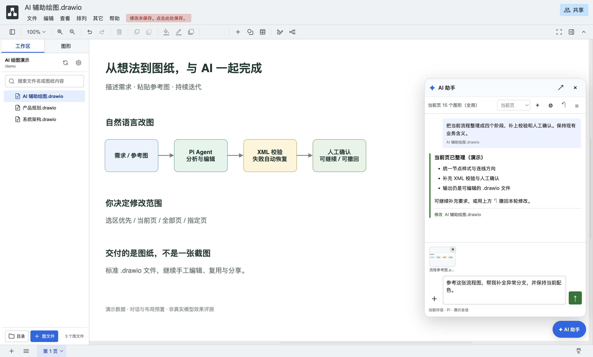
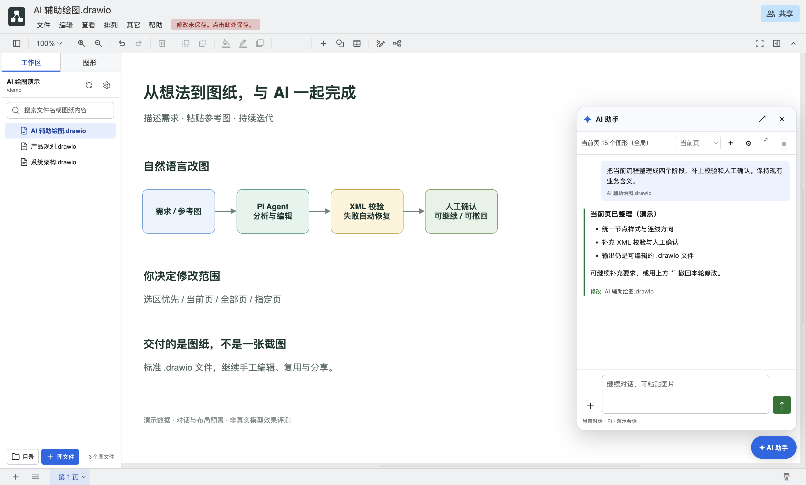
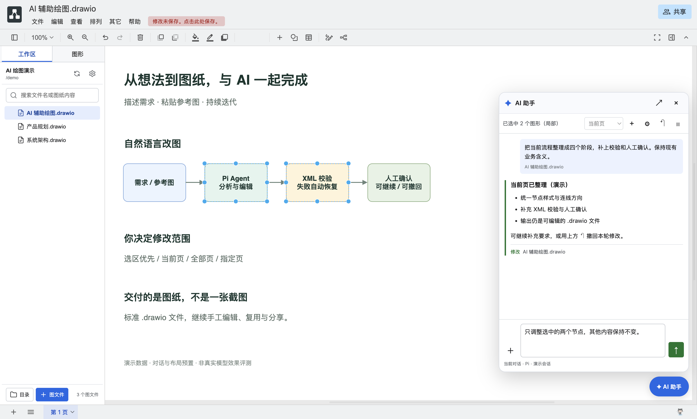

<p align="center">
  
</p>

<h1 align="center">draw.ai</h1>

<p align="center">
  Turn prompts and reference images into editable diagrams with an AI assistant.
</p>

<p align="center">
  <a href="README.zh-CN.md">简体中文</a> · English
</p>

<p align="center">
  <a href="https://github.com/tangf-ai/draw.ai/actions/workflows/ci.yml"></a>
  <a href="LICENSE"></a>
</p>

**An AI workspace that edits your diagrams, not just talks about them.** Describe a change, attach a reference image, or select a few shapes for a focused edit. The Pi-powered assistant works directly on standard `.drawio` files: keep editing by hand, iterate in conversation, inspect changed files, or roll back the latest AI change.

The local-first workspace, templates, and mature draw.io editor work independently of AI. AI requests use your locally installed Pi and configured model.

> draw.ai is an independent community project based on the Apache-2.0-licensed draw.io projects. It is not affiliated with, endorsed by, or supported by draw.io Ltd or JGraph. draw.io is a trademark of its respective owner.

<p align="center">
  
</p>

<p align="center"><sub>Reference images and prompts beside the real editor. Staged demo conversation/layout; no model was called.</sub></p>

## Features

- **AI image input (new in v0.1.8)**: paste or select reference images, preview/remove them, and send with or without text. Add images to an active task as follow-up instructions. Up to four PNG/JPEG/WebP/GIF images per message, 5 MiB each; image understanding depends on the selected Pi model.
- **Natural-language diagram editing**: ask the assistant to draft or refine flows and styles directly in editable diagram files, rather than producing a flattened image.

- **Unified workspace**: create folders and diagrams, search, import, rename, duplicate, move, reveal, and move files to the system trash from one window.
- **Directory moves**: drag folders in the workspace tree/list or choose a destination with Move; opened diagrams follow the new path.
- **Reusable diagram template**: configure the content used for every new diagram.
- **Synchronized template source**: track a template in iCloud Drive or another synchronized folder, detect newer external versions, and explicitly update the local hidden working copy.
- **Workspace Agent**: use a Pi-powered conversation beside the editor. The Agent reads and edits the workspace's `.drawio` files directly, validates the resulting XML, and reloads the active diagram.
- **Selection and Page scope**: a shape selection always takes precedence. Without a selection, target the current Page, every Page, or explicitly selected Pages.
- **Persistent conversations**: continue a task with follow-up instructions while Pi is working, stop the current run, or start a fresh conversation for the workspace.
- **Checkpoint rollback**: draw.ai snapshots workspace diagrams before each Agent run, restores invalid edits automatically, and lets you roll back the latest successful change.
- **Cross-platform packaging**: macOS, Windows, and Linux build configurations are included.

## Interface preview

The new AI screenshots render the real editor and assistant with isolated fictional data. Conversations and diagram layouts are staged; no Pi/model request is made. They illustrate the UI, not measured model quality or latency, and contain no real accounts or business data.

### Reference images + instructions

Paste an image or use the attachment button, preview it, and add your request. This screenshot shows an unsent draft; image understanding requires a vision-capable model configured in Pi.


### Conversation + editable output

Request changes beside the canvas, inspect changed files, and keep iterating. The result remains a standard, editable `.drawio` file.



### Selection scope + rollback

Selected shapes take precedence over Page scope. Pre-run checkpoints and XML validation support recovery and rollback; they are not an OS sandbox.



### Unified workspace

Organize folders, diagrams, and templates locally, including folder drag-and-drop moves. Workspace interface example:


## Quick start

Requirements: Git, Node.js 22.12 or newer, and npm.

```bash
git clone --recursive https://github.com/tangf-ai/draw.ai.git
cd draw.ai
npm install
npm test
npm start
```

The repository uses two branches in the same GitHub project:

- `main`: Electron desktop application and workspace features.
- `editor`: draw.ai's editor fork, checked out at `drawio/` as a Git submodule.

If the repository was cloned without `--recursive`, initialize the editor with:

```bash
git submodule update --init --recursive
```

## Using the Workspace Agent

The Workspace Agent requires the local Pi CLI (`pi`) to be installed and authenticated.
Pi is required only for Agent requests; the workspace, templates, and diagram editor continue to work locally without it.

1. Select a diagram workspace and open a `.drawio` file from the left sidebar.
2. Click **✦ AI 助手** (AI assistant) in the lower-right corner.
3. Select shapes to restrict the change to those shapes, or choose the current, all, or specific Page scope. When shapes are selected, selection scope takes precedence and the Page selector is disabled.
4. Enter a request, paste reference images, or select images with the attachment button; image-only messages are supported. While Pi is working, additional text/images are added to the same active task.
5. Answer any extension confirmation or selection dialog shown in the Agent panel before the run continues. The active diagram reloads after a successful edit.
6. Use the rollback button to restore the diagrams captured before the latest successful Agent run. Rollback is refused if a changed file has been edited again, preventing newer work from being overwritten.

Conversations are retained per workspace. The Agent can edit multiple Pages in the selected scope. It edits another diagram file only when the request explicitly names that file. Invalid draw.io XML is rejected and automatically restored from the pre-run checkpoint.

The assistant has one floating panel in the lower-right corner. The former **Quick Edit**, in-app provider/API-key settings, and correction-memory UI are not part of this architecture. Authentication and provider configuration belong to your Pi installation; the assistant settings expose **Pi command** and **model**. Reference images require a compatible vision model. draw.ai does not bundle a model or free inference service.

## Agent safety model

Each Agent run follows a file-based, recoverable workflow:

1. draw.ai saves the active editor state before handing the task to Pi.
2. Every `.drawio` file in the workspace is copied to a local pre-run checkpoint.
3. draw.ai starts or resumes a persistent Pi session (`pi --mode rpc`) with the workspace as its working directory. Pi runs with the permissions of the local user account; draw.ai surfaces Pi extension dialogs in the Agent panel for confirmation.
4. The request includes the active file plus the authoritative selection or Page context. Pi edits the `.drawio` files directly while progress, commands, and file activity stream into the Agent panel.
5. draw.ai compares the workspace with the checkpoint, rejects diagram-file deletion, validates every changed or created draw.io XML file, and reloads the active diagram.
6. Failed, interrupted, unsafe, or invalid runs are restored automatically. The latest successful run remains available for explicit rollback.

Pi does not provide a built-in sandbox, so diagram safety comes from draw.ai's checkpoint, validation, and rollback workflow rather than from an engine-side write restriction. Keep the workspace pointed at a dedicated diagram folder and review the Agent's activity while it runs.

## Templates and iCloud

The editable working template is stored as a hidden file managed by draw.ai. Importing or updating a template replaces that hidden working copy after confirmation. When the source template is stored in iCloud Drive, draw.ai records the source and checks whether it has changed before the template is used or managed; synchronization of the source file itself remains iCloud's responsibility.

## Privacy

Workspace and diagram editing are local by default. The Agent starts the locally installed Pi CLI only after the user submits a request. Pi receives the request, submitted reference images, the permitted Page or selection context, and access to `.drawio` files inside the selected workspace; it may use model services according to the user's Pi configuration. Review the applicable data retention and privacy terms before use.

Image contents are sent to Pi and may be retained in Pi sessions and sent to the configured model provider. draw.ai's own conversation list retains image names/types, not raw image content.

Agent conversation metadata and recovery checkpoints are stored in draw.ai's local application data, separately from the diagram workspace. They are not synchronized through the workspace's iCloud folder. Checkpoints contain local copies of workspace diagrams so that failed runs and the latest successful change can be restored.

The application checks this GitHub repository for updates unless checks are disabled with `DRAWIO_DISABLE_UPDATE=true` or `--disable-update`. Diagrams can also load external media referenced by URL.

## Development and packaging

Use `DRAWIO_ENV=dev npm start` to open renderer development tools. Before submitting a change, run:

```bash
npm test
git diff --check
git -C drawio diff --check
```

Create an unsigned Apple Silicon macOS installer with:

```bash
DRAWIO_UNSIGNED=true CSC_IDENTITY_AUTO_DISCOVERY=false \
  npx electron-builder --config electron-builder-linux-mac.json \
  --mac dmg --arm64 --publish never
```

Unsigned artifacts are intended for local testing. Public macOS releases should use a project-controlled Developer ID and Apple notarization.

More information:

- [Development guide](DEVELOPMENT.md)
- [Local build guide](doc/BUILDING_FOR_PERSONAL_USE.md)
- [Upstream maintenance](doc/UPSTREAM_MAINTENANCE.md)
- [Release process](doc/RELEASE_PROCESS.md)
- [Security policy](SECURITY.md)

## Compatibility and license

The application uses its own identifiers (`ai.draw.desktop`, `ai.draw.diagram`, and `draw-ai`) while retaining the `.drawio` extension and `application/vnd.jgraph.mxfile` MIME type for compatibility.

Licensed under the Apache License 2.0. See [LICENSE](LICENSE) and [NOTICE](NOTICE).
