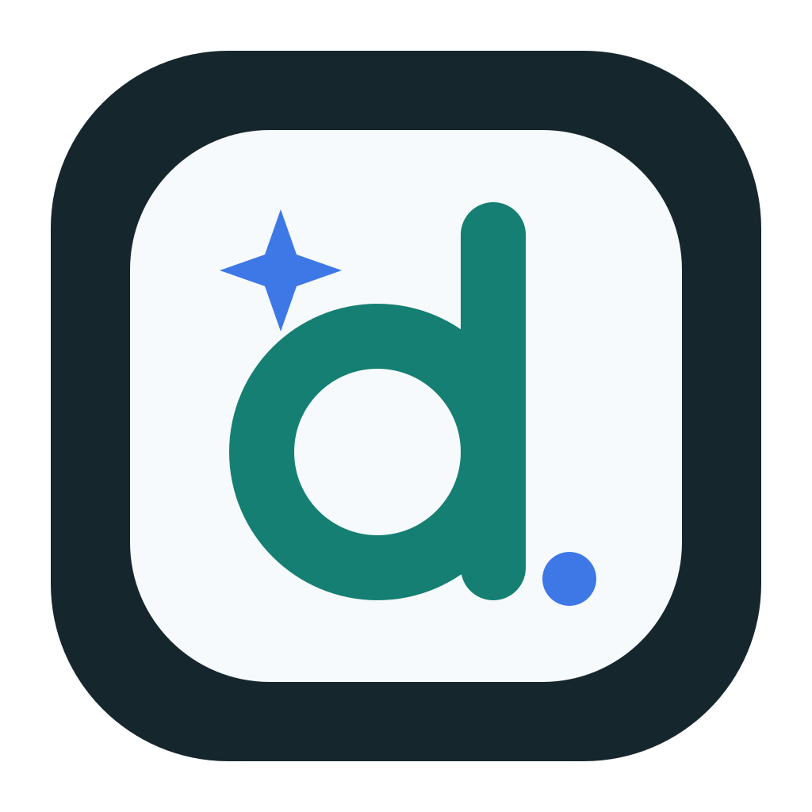

<p align="center">
  
</p>

<h1 align="center">draw.ai</h1>

<p align="center">
  一个本地优先、支持 AI 的桌面图形工作区。
</p>

<p align="center">
  简体中文 · <a href="README.md">English</a>
</p>

<p align="center">
  <a href="https://github.com/tangf-ai/draw.ai/actions/workflows/ci.yml"></a>
  <a href="LICENSE"></a>
</p>

draw.ai 把统一文件工作区、可复用模板、支持图片理解的 AI 助手和成熟的 draw.io 编辑器整合到一个开源桌面应用中。创建的图仍然是标准、可编辑的 `.drawio` 文件。

> draw.ai 是基于 Apache-2.0 许可证 draw.io 项目的独立社区项目，与 draw.io Ltd 或 JGraph 没有关联，也未获得其认可或支持。draw.io 是其权利人的商标。

## 核心功能

- **统一工作区**：在一个窗口中创建目录和图文件，并完成搜索、导入、重命名、复制、移动、在访达中显示和移到系统废纸篓等操作。
- **新建图模板**：可以配置统一模板，后续新建图时自动使用模板内容。
- **模板同步检查**：可以跟踪 iCloud Drive 或其他同步目录中的模板源文件，识别外部更新，并由用户确认后更新本地隐藏工作模板。
- **AI 图形助手**：围绕当前图进行对话，生成可编辑图形，预览并应用修改，也可以回撤最近一次 AI 应用。
- **图片生成图形**：支持上传、粘贴或拖入 PNG、JPEG、WebP 图片，将截图或手绘草稿还原为可编辑的方框、连线、文字和层级关系。
- **AI 配置**：支持 OpenAI 兼容接口，可在应用内配置接口地址、API Key、模型、系统提示词和优化指令。
- **跨平台构建**：包含 macOS、Windows 和 Linux 的打包配置。

## 快速开始

需要安装 Git、Node.js 22.12 或更高版本以及 npm。

```bash
git clone --recursive https://github.com/tangf-ai/draw.ai.git
cd draw.ai
npm install
npm test
npm start
```

同一个 GitHub 仓库使用两个分支管理完整代码：

- `main`：Electron 桌面应用、工作区和模板等功能。
- `editor`：draw.ai 编辑器分支，通过 `drawio/` Git 子模块固定到具体版本。

如果克隆时没有使用 `--recursive`，可以补充执行：

```bash
git submodule update --init --recursive
```

## 使用 AI 助手

1. 打开一个图，在右侧边栏选择“AI 助手”。
2. 打开 AI 设置，配置 OpenAI 兼容接口地址、API Key 和模型；使用图片时需要选择支持视觉理解的模型。
3. 输入绘图要求，也可以粘贴、上传或拖入参考图片或手绘草稿。
4. 检查 AI 给出的图形修改方案，再确认应用。
5. 应用后可以使用“回撤”恢复到本次 AI 修改之前。

图片会在本地按需缩放，只随当前这一次请求发送。单张图片默认最大 10 MB，提交前最长边会缩放到不超过 2048 像素。

## 模板与 iCloud 同步

draw.ai 实际使用的工作模板由应用以隐藏文件方式管理。导入模板或确认更新模板时，会覆盖这份隐藏工作模板。当模板源文件位于 iCloud Drive 中时，draw.ai 会记录源文件位置，并在使用或管理模板前检查它是否有新版本；源文件本身的跨设备同步仍由 iCloud 完成。

这种设计让多个设备可以共享同一个模板源，同时避免 iCloud 下载中、同步冲突或源文件暂时不可用时直接破坏新建图流程。

## 隐私说明

工作区管理和图形编辑默认都在本地完成。只有在用户配置 AI 服务并主动发送消息后，应用才会发起 AI 请求。请求可能包含输入内容、配置的提示词、与任务相关的图形结构以及本次附带的图片。请确认所使用 AI 服务商的数据保留和隐私政策。

应用默认检查本 GitHub 仓库的新版本，可通过 `DRAWIO_DISABLE_UPDATE=true` 或 `--disable-update` 关闭。图文件中通过 URL 引用的外部图片、字体等资源，也可能在打开图时产生网络请求。

## 开发与打包

使用 `DRAWIO_ENV=dev npm start` 可以打开渲染进程开发工具。提交代码前请运行：

```bash
npm test
git diff --check
git -C drawio diff --check
```

在 Apple Silicon Mac 上生成未公证的本地 DMG：

```bash
DRAWIO_UNSIGNED=true CSC_IDENTITY_AUTO_DISCOVERY=false \
  npx electron-builder --config electron-builder-linux-mac.json \
  --mac dmg --arm64 --publish never
```

未签名或临时签名的安装包仅适合本地测试。公开发布的 macOS 版本应使用项目自己的 Developer ID 并完成 Apple 公证。

更多文档：

- [开发指南](DEVELOPMENT.md)
- [本地构建指南](doc/BUILDING_FOR_PERSONAL_USE.md)
- [上游同步维护](doc/UPSTREAM_MAINTENANCE.md)
- [发布流程](doc/RELEASE_PROCESS.md)
- [安全策略](SECURITY.md)

## 兼容性与许可证

应用使用独立标识 `ai.draw.desktop`、`ai.draw.diagram` 和 `draw-ai`，同时保留 `.drawio` 扩展名及 `application/vnd.jgraph.mxfile` MIME 类型，以兼容现有 draw.io 文件。

项目采用 Apache License 2.0，详见 [LICENSE](LICENSE) 和 [NOTICE](NOTICE)。
