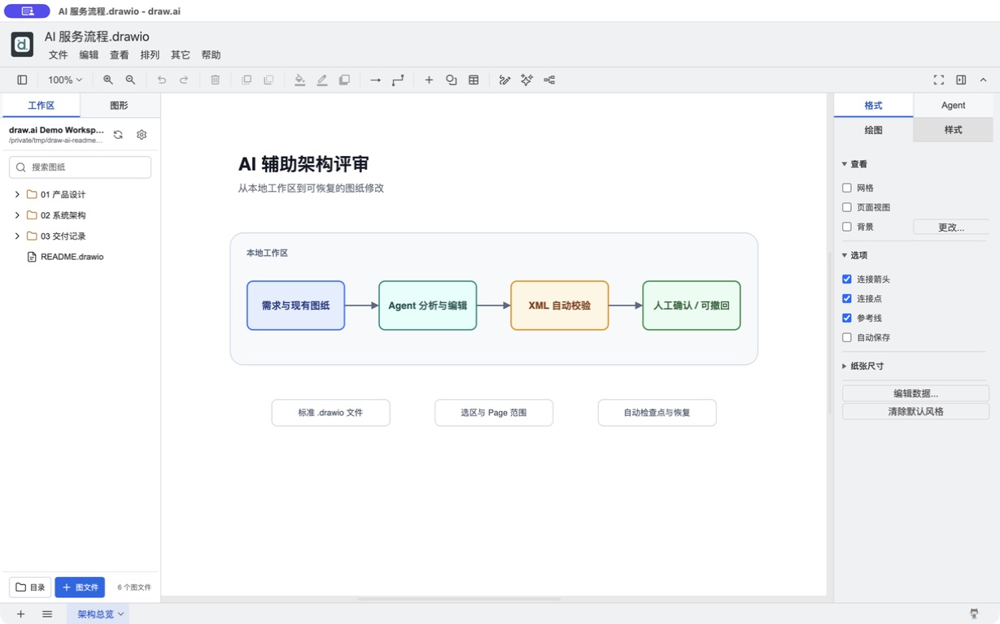
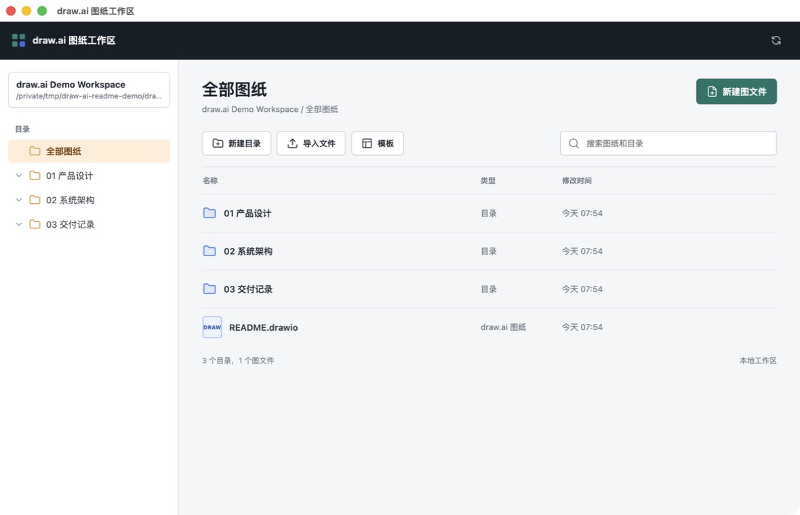
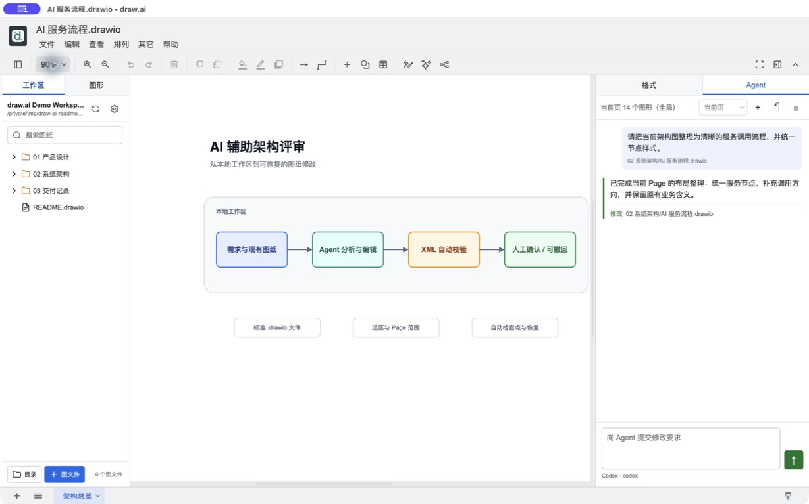

<p align="center">
  
</p>

<h1 align="center">draw.ai</h1>

<p align="center">
  一个本地优先、支持 AI 的桌面图形工作区。
</p>

<p align="center">
  简体中文 · <a href="README.md">English</a>
</p>

<p align="center">
  <a href="https://github.com/tangf-ai/draw.ai/actions/workflows/ci.yml"></a>
  <a href="LICENSE"></a>
</p>

draw.ai 把统一文件工作区、可复用模板、基于 Pi 的图形 Agent 和成熟的 draw.io 编辑器整合到一个开源桌面应用中。创建的图仍然是标准、可编辑的 `.drawio` 文件。

> draw.ai 是基于 Apache-2.0 许可证 draw.io 项目的独立社区项目，与 draw.io Ltd 或 JGraph 没有关联，也未获得其认可或支持。draw.io 是其权利人的商标。

<p align="center">
  
</p>

<p align="center"><sub>在同一桌面窗口中管理图文件并使用完整的 draw.io 编辑器。</sub></p>

## 核心功能

- **统一工作区**：在一个窗口中创建目录和图文件，并完成搜索、导入、重命名、复制、移动、在访达中显示和移到系统废纸篓等操作。
- **新建图模板**：可以配置统一模板，后续新建图时自动使用模板内容。
- **问题树模式**：在左侧“图形 → 常用 → 绘图模式”选择“问题树（向下）”，按 Tab 自动添加下一级节点与向下箭头；编辑文字时按 Enter 向右添加同级，Shift+Enter 换行。模式随当前 Page 保存。
- **模板同步检查**：可以跟踪 iCloud Drive 或其他同步目录中的模板源文件，识别外部更新，并由用户确认后更新本地隐藏工作模板。
- **工作区 Agent**：在编辑器右侧使用基于 Pi 的对话。Agent 直接读取和修改工作区中的 `.drawio` 文件，校验 XML 后重新载入当前图。
- **选区与 Page 范围**：选中图形时始终只作用于选区；没有选中时可选择当前 Page、全部 Page 或指定 Page。
- **持续对话**：Pi 执行期间可以继续补充要求，也可以停止当前任务，或为工作区开始一个新对话。
- **检查点撤回**：每轮 Agent 执行前自动备份工作区图纸；无效修改会自动恢复，成功修改也可由用户撤回。
- **跨平台构建**：包含 macOS、Windows 和 Linux 的打包配置。

## 界面预览

以下截图均使用虚构演示数据，不包含真实工作区、账号、对话或业务信息。

### 统一工作区

集中创建和整理目录、标准 `.drawio` 文件与默认模板，无需在不同位置查找图纸。



### 工作区 Agent

在图形编辑器旁提交修改要求、限定 Page 或选区范围、查看文件变更，并在需要时撤回最近一次修改。



## 快速开始

需要安装 Git、Node.js 22.12 或更高版本以及 npm。

```bash
git clone --recursive https://github.com/tangf-ai/draw.ai.git
cd draw.ai
npm install
npm test
npm start
```

同一个 GitHub 仓库使用两个分支管理完整代码：

- `main`：Electron 桌面应用、工作区和模板等功能。
- `editor`：draw.ai 编辑器分支，通过 `drawio/` Git 子模块固定到具体版本。

如果克隆时没有使用 `--recursive`，可以补充执行：

```bash
git submodule update --init --recursive
```

## 使用工作区 Agent

工作区 Agent 需要本机已安装并登录 Pi CLI（`pi`）。
只有使用 Agent 时才需要 Pi；工作区管理、模板和图形编辑器在没有 Pi 时仍可完全本地使用。

1. 选择图纸工作区，并从左侧打开一个 `.drawio` 文件。
2. 在右侧边栏打开“Agent”。
3. 选中图形可把修改限制在选区；没有选中时，可选择当前、全部或指定 Page 范围。存在选区时，选区优先，Page 范围选择器会被禁用。
4. 输入修改要求。Pi 执行期间再次发送消息，会作为补充要求加入当前任务。
5. Pi 扩展弹出的确认或选择对话框会显示在 Agent 面板中，需要用户处理后任务才会继续；修改成功后，当前图会自动重新载入。
6. 使用撤回按钮，可以恢复最近一次 Agent 执行前备份的图纸。如果相关文件后来又被编辑过，系统会拒绝撤回，避免覆盖更新的内容。

每个工作区会保留独立的对话记录。Agent 可以操作所选范围内的多个 Page；只有在要求中明确点名另一个图文件时，才会修改其他图文件。如果修改后的 draw.io XML 无效，应用会自动恢复执行前的检查点。

当前版本有意在“格式”旁只保留一个 Agent 入口。旧版“快速编辑”、应用内模型与 API Key 配置、图片附件生成图以及纠错记忆界面不属于这套新架构；登录、模型和服务商配置由用户本机的 Pi 负责，也可以在 Agent 设置对话框中填写 **Pi 命令**和**模型**。

## Agent 安全机制

每轮 Agent 都按可恢复的文件流程执行：

1. draw.ai 先保存编辑器中的当前图，确保 Pi 读取的是最新文件。
2. 将工作区内所有 `.drawio` 文件复制到应用本地的执行前检查点。
3. 以工作区为工作目录启动或恢复持久 Pi 会话（`pi --mode rpc`）。Pi 以当前系统用户的权限运行；Pi 扩展弹出的对话框会显示在 Agent 面板中由用户确认。
4. 请求会携带当前文件以及具有约束力的选区或 Page 上下文。Pi 直接修改 `.drawio` 文件，执行进度、命令和文件活动会实时显示在 Agent 面板中。
5. draw.ai 对比执行前后的工作区，拒绝删除图文件，校验所有新增或修改的 draw.io XML，并重新载入当前图。
6. 执行失败、停止、越权或 XML 无效时自动恢复；最近一次成功修改仍可由用户主动撤回。

Pi 不提供内置沙箱，因此图纸安全依赖 draw.ai 的检查点、校验与撤回流程，而不是引擎侧的写入限制。建议把工作区指向专门的图纸目录，并在 Agent 执行期间关注面板中的活动。

## 模板与 iCloud 同步

draw.ai 实际使用的工作模板由应用以隐藏文件方式管理。导入模板或确认更新模板时，会覆盖这份隐藏工作模板。当模板源文件位于 iCloud Drive 中时，draw.ai 会记录源文件位置，并在使用或管理模板前检查它是否有新版本；源文件本身的跨设备同步仍由 iCloud 完成。

这种设计让多个设备可以共享同一个模板源，同时避免 iCloud 下载中、同步冲突或源文件暂时不可用时直接破坏新建图流程。

## 隐私说明

工作区管理和图形编辑默认都在本地完成。只有用户提交要求后，应用才会启动本机已安装的 Pi CLI。Pi 会收到用户要求、允许处理的 Page 或选区上下文，并可访问所选工作区中的 `.drawio` 文件；它可能按用户的 Pi 配置使用模型服务。使用前请确认相应的数据保留与隐私政策。

Agent 对话元数据和恢复检查点保存在 draw.ai 的本地应用数据中，与图纸工作区分开，不会通过工作区所在的 iCloud 目录同步。检查点包含工作区图纸的本地副本，用于自动恢复失败任务和撤回最近一次成功修改。

应用默认检查本 GitHub 仓库的新版本，可通过 `DRAWIO_DISABLE_UPDATE=true` 或 `--disable-update` 关闭。图文件中通过 URL 引用的外部图片、字体等资源，也可能在打开图时产生网络请求。

## 开发与打包

使用 `DRAWIO_ENV=dev npm start` 可以打开渲染进程开发工具。提交代码前请运行：

```bash
npm test
git diff --check
git -C drawio diff --check
```

在 Apple Silicon Mac 上生成未公证的本地 DMG：

```bash
DRAWIO_UNSIGNED=true CSC_IDENTITY_AUTO_DISCOVERY=false \
  npx electron-builder --config electron-builder-linux-mac.json \
  --mac dmg --arm64 --publish never
```

未签名或临时签名的安装包仅适合本地测试。公开发布的 macOS 版本应使用项目自己的 Developer ID 并完成 Apple 公证。

更多文档：

- [开发指南](DEVELOPMENT.md)
- [本地构建指南](doc/BUILDING_FOR_PERSONAL_USE.md)
- [上游同步维护](doc/UPSTREAM_MAINTENANCE.md)
- [发布流程](doc/RELEASE_PROCESS.md)
- [安全策略](SECURITY.md)

## 兼容性与许可证

应用使用独立标识 `ai.draw.desktop`、`ai.draw.diagram` 和 `draw-ai`，同时保留 `.drawio` 扩展名及 `application/vnd.jgraph.mxfile` MIME 类型，以兼容现有 draw.io 文件。

项目采用 Apache License 2.0，详见 [LICENSE](LICENSE) 和 [NOTICE](NOTICE)。
